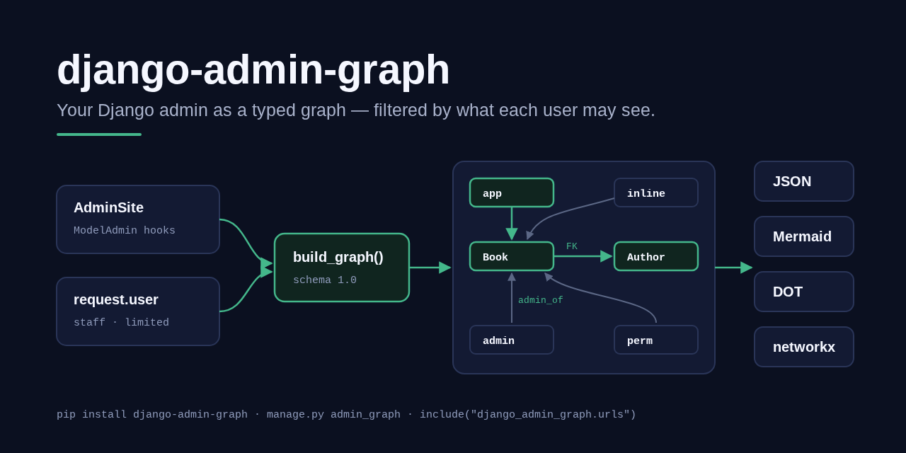
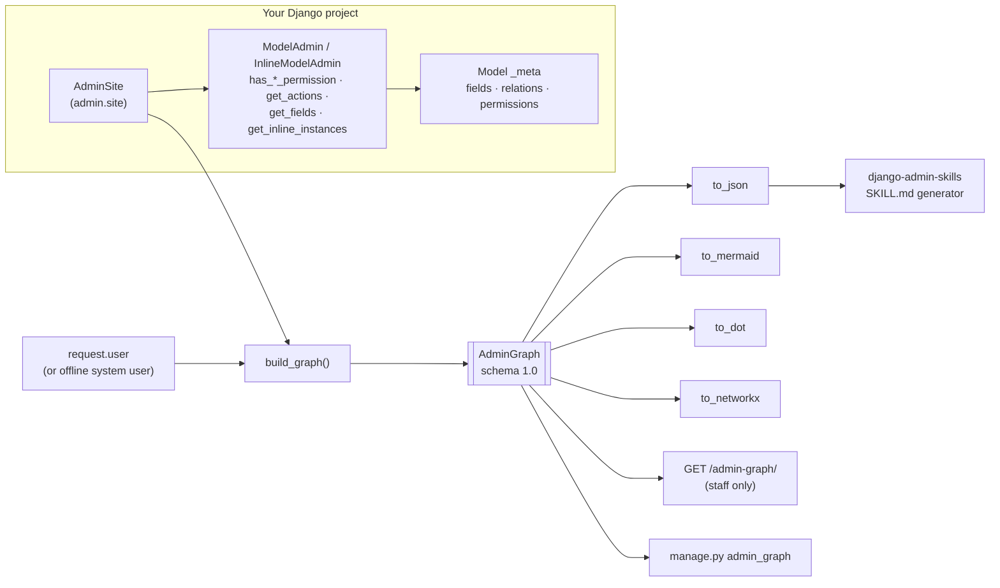

# django-admin-graph

> Your Django admin site as a typed graph — apps, models, relations, ModelAdmins, actions and permissions — **filtered by what the requesting user may see.**

[](https://github.com/MartinCastroAlvarez/django-admin-graph/actions/workflows/ci.yml)
[](LICENSE)
[](pyproject.toml)
[](https://www.djangoproject.com/)
[](docs/schema.md)
[](pyproject.toml)



`django-admin-graph` reads `django.contrib.admin.site` (or any `AdminSite`)
and returns one JSON-serialisable graph: **nodes** for apps, models (fields
with types, choices, `null`, `help_text`), ModelAdmins (`list_display`,
`search_fields`, `list_filter`, actions, inlines, read-only fields) and
permissions; **edges** for FK / O2O / M2M relations, inline-of, admin-of and
permission-of. Export it as JSON, a Mermaid `erDiagram`, GraphViz DOT or a
`networkx` graph — from Python, from `manage.py`, or from a staff-only URL.

| Project | Role | PyPI |
| --- | --- | --- |
| [`django-admin-react`](https://github.com/MartinCastroAlvarez/django-admin-react) | React single-page admin frontend | [`django-admin-react`](https://pypi.org/project/django-admin-react/) |
| [`django-admin-rest-api`](https://github.com/MartinCastroAlvarez/django-admin-rest-api) | JSON REST API over `ModelAdmin` | [`django-admin-rest-api`](https://pypi.org/project/django-admin-rest-api/) |
| [`django-admin-mcp-api`](https://github.com/MartinCastroAlvarez/django-admin-mcp-api) | MCP server exposing the same API to LLMs | [`django-admin-mcp-api`](https://pypi.org/project/django-admin-mcp-api/) |
| **`django-admin-graph`** *(this repo)* | The admin site as a typed, versioned graph | `django-admin-graph` |
| [`django-admin-skills`](https://github.com/MartinCastroAlvarez/django-admin-skills) | Agent Skills (`SKILL.md`) generated from the graph | `django-admin-skills` |

---

## Why

Agents, docs generators, ERD tools and admin frontends all need the same
answer: *what does this admin look like, and what may this user do in it?*
Every project re-derives it from `_meta` and `ModelAdmin` attributes, gets
the request-aware hooks wrong (`get_list_display(request)`,
`get_actions(request)`, `get_inline_instances(request)`), and leaks models a
user cannot open. This package answers it once:

- **The admin decides, not us.** Visibility comes from
  `AdminSite.has_permission`, `ModelAdmin.has_module_permission`,
  `get_model_perms`, `has_*_permission`, `get_actions`,
  `get_inline_instances`, `get_fields`. There is no parallel permission
  system and no `user.has_perm` in the package.
- **No leaks.** A model the user cannot see is not a node, and is never
  *named* — a FK pointing at it has `target: null`. Fields the ModelAdmin
  excludes are not listed. Record data is never read.
- **A stable contract.** `schema_version` follows a written compatibility
  rule ([`docs/schema.md`](docs/schema.md)) and ships with a JSON Schema
  ([`schema.json`](django_admin_graph/schema.json)), so
  [`django-admin-skills`](https://github.com/MartinCastroAlvarez/django-admin-skills)
  and your own tools can consume a saved file without importing your project.

## Quickstart

```bash
pip install django-admin-graph                      # + "[networkx]" for to_networkx
# settings.py: INSTALLED_APPS += ["django_admin_graph"]
python manage.py admin_graph --format mermaid > admin.mmd
python manage.py admin_graph --format json --app library -o graph.json
python manage.py admin_graph --format dot | dot -Tsvg > admin.svg
```

From Python:

```python
from django_admin_graph import build_graph, to_json, to_mermaid

graph = build_graph()                    # offline: the whole site (system user)
graph = build_graph(request=request)     # exactly what request.user may see
book = graph.model("library.Book")
book.field("author").relation            # Relation(kind='foreign_key', target='model:library.author', ...)
graph.admin_for("library.Book").actions  # (ActionInfo(name='mark_published', ...), ...)
print(to_mermaid(graph))
```

Optional staff-only JSON endpoint:

```python
# urls.py
urlpatterns = [
    path("admin/", admin.site.urls),
    path("admin-graph/", include("django_admin_graph.urls")),  # GET → this user's graph
]
```

`GET /admin-graph/?app=library` returns `401` for anonymous users, `403` for
anyone `AdminSite.has_permission` refuses, and otherwise the requester's
graph with `Cache-Control: private, no-store`.

## Architecture



## How it works

1. **Gate.** With a `request`, `AdminSite.has_permission(request)` must pass
   (active staff by default) or `build_graph` raises `NotAuthenticated` /
   `PermissionDenied`. Without one, a synthetic, unsaved *system user* is
   used — the site as an active superuser sees it. That mode is for offline
   tooling and is never reachable over HTTP.
2. **Visibility.** A registered model is in the graph when its ModelAdmin's
   `has_module_permission` is true and `get_model_perms` grants anything —
   the same rule the admin index uses. Exclusions in settings only remove.
3. **Shape.** For each visible model: fields the ModelAdmin exposes (change
   form if the user may view/change, add form if they may add, read-only
   fields, `list_display`), relation targets limited to visible models,
   request-aware `list_display` / `list_filter` / `search_fields` /
   `ordering` / fieldsets, `get_actions(request)` (already permission
   filtered), `get_inline_instances(request)` (likewise), and permission
   nodes whose `granted` is the ModelAdmin's own `has_<action>_permission`.
4. **Export.** The frozen dataclasses serialise deterministically, so a
   graph committed to the repo diffs cleanly.

Node ids are stable strings: `app:library`, `model:library.book`,
`admin:library.book`, `inline:library.book:library.review`,
`permission:library.view_book`. The full contract is in
[`docs/schema.md`](docs/schema.md).

## Configuration

All settings live under one optional dict:

| Setting | Default | Meaning |
| --- | --- | --- |
| `DJANGO_ADMIN_GRAPH["ADMIN_SITE"]` | `"django.contrib.admin.site"` | Dotted path (or instance) of the `AdminSite` the view and command read. |
| `DJANGO_ADMIN_GRAPH["EXCLUDE_APPS"]` | `[]` | App labels never graphed, for anyone. |
| `DJANGO_ADMIN_GRAPH["EXCLUDE_MODELS"]` | `[]` | `"app_label.Model"` labels never graphed; relations to them get `target: null`. |

Command options: `--format json|mermaid|dot`, `--app LABEL` (repeatable),
`--site dotted.path`, `--output FILE`, `--indent N` (0 = compact).

## Testing

```bash
poetry install --all-extras
poetry run pytest                         # 75 tests, ~98% branch coverage
poetry run ruff check django_admin_graph tests && poetry run ruff format --check django_admin_graph tests
poetry run mypy django_admin_graph        # strict
poetry run bandit -c pyproject.toml -q -r django_admin_graph && poetry run pip-audit
```

The security suite (`tests/test_security.py`) builds the graph as an
anonymous user, a non-staff user with model permissions, an inactive staff
user, staff with no permissions, staff who may only view one model, an
editor and a superuser, and asserts that hidden models are never named,
excluded fields never appear, and no row is ever queried. CI runs the suite
on Python 3.11–3.13 × Django 4.2 / 5.0 / 5.1 / 5.2 / 6.0 / 6.1.

## Part of the series

| Series | Repositories |
| --- | --- |
| Django admin family | [django-admin-react](https://github.com/MartinCastroAlvarez/django-admin-react) · [django-admin-rest-api](https://github.com/MartinCastroAlvarez/django-admin-rest-api) · [django-admin-mcp-api](https://github.com/MartinCastroAlvarez/django-admin-mcp-api) · **django-admin-graph** · [django-admin-skills](https://github.com/MartinCastroAlvarez/django-admin-skills) |
| Agent tooling | [agent-lint](https://github.com/MartinCastroAlvarez/agent-lint) · [repo-graph-mcp](https://github.com/MartinCastroAlvarez/repo-graph-mcp) · [s3-agent-memory](https://github.com/MartinCastroAlvarez/s3-agent-memory) · [pytest-llm-evals](https://github.com/MartinCastroAlvarez/pytest-llm-evals) · [serverless-mcp-aws](https://github.com/MartinCastroAlvarez/serverless-mcp-aws) · [agent-model-router](https://github.com/MartinCastroAlvarez/agent-model-router) |
| Patterns catalog | [agentic-architectures](https://github.com/MartinCastroAlvarez/agentic-architectures) — every agent pattern, linking the LangGraph, ADK, CrewAI and LangChain repos |

## Contributing

See [`CONTRIBUTING.md`](CONTRIBUTING.md), [`ARCHITECTURE.md`](ARCHITECTURE.md),
[`SECURITY.md`](SECURITY.md) and the agent contract in [`CLAUDE.md`](CLAUDE.md).

## License

MIT © 2026 Martín Castro Álvarez. See [LICENSE](LICENSE).
